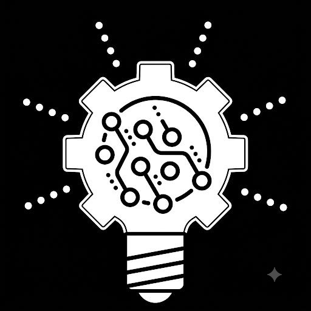
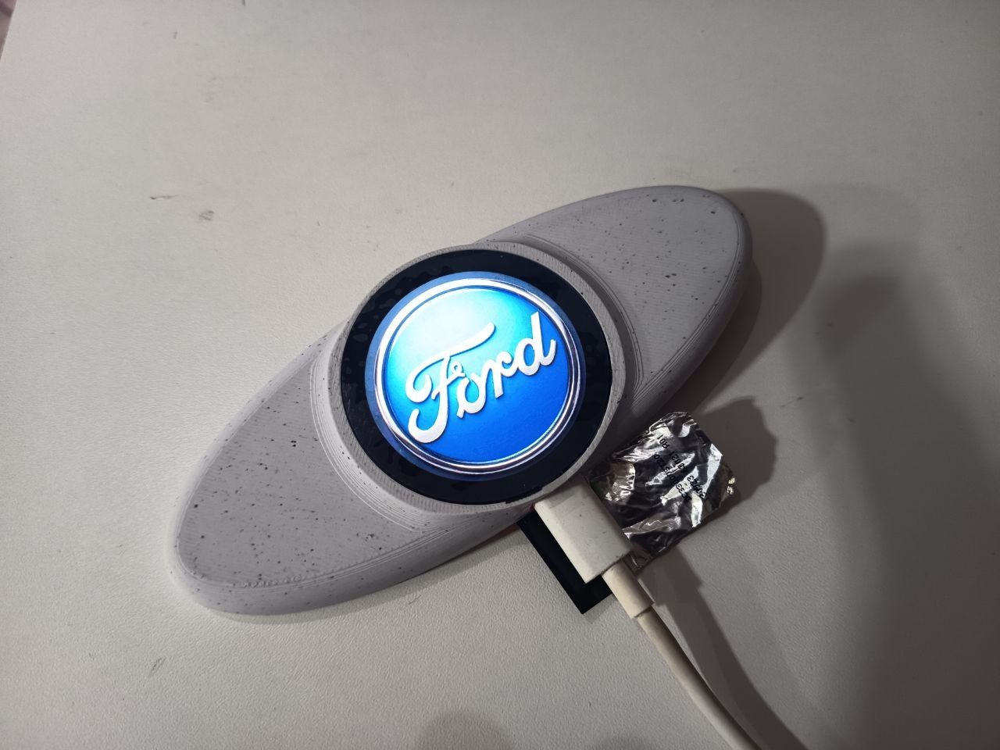

# My developer logo

# Car_emblem_badge_controller_ford_ka_2015
Car Emblem Badge Controller Project
Based on Waveshare ESP32-S3-TOUCH-LCD-1.85 development board
The libararies from list are standart for this board:
  - Display_ST77916
  - I2C_Driver
  - TCA9554PWR
  - Touch_CST816
  - esp_lcd_st77916
  - MediaStorage/SD_card

Ble_handler is for remote communication via BLE
commands_handler is for serial and BLE controle (like a FS features (copy, delete...), show image)
logo_anim and eye_animation is method for draw the image using basic primitives (circle, line, rectangle)

My custom partitions table should be add to compilator.

Any question, contact me: romulsre@gmail.com

My TG channel: https://t.me/reparoseletronica

# Working example

# Support
If you find this project useful, consider supporting its development:

➡️ Donate
"https://github.com/romulsre/car_emblem_badge_controller_ford_ka_2015/blob/main/DONATE.md"
