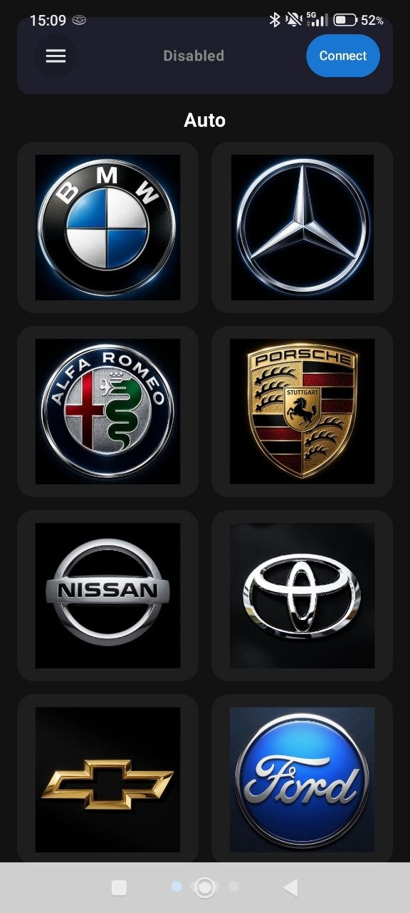

# My developer logo

# ble_badgecontrol.apk
Built this project using updated "Android studio"

The logo library should be loaded into the controller via an SD card. Directory /logos/xxxx.bin
In this repository, I have attached two logos: BMW and Ford.

Any question, contact me: romulsre@gmail.com
My TG channel: https://t.me/reparoseletronica

# Working example

# Badge example picture

